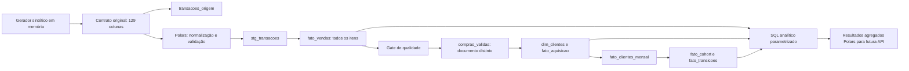

# Arquitetura

A execução é local, determinística e exclusivamente sintética. A entrada não implementa leitores de arquivos empresariais nem conectores de rede. `SyntheticDataset` é um contrato de procedência para desenvolvimento; não é um mecanismo capaz de provar a origem de um DataFrame arbitrário fornecido por outro programa.

## Componentes

`config` centraliza referência, chave documental oficial de quatro campos, aliases e políticas confirmadas. `schemas` valida nomes e tipos de identificadores. `ingestion` aceita apenas dados sintéticos em memória. `transformations` normaliza texto, datas e identidade em expressões Polars. `sales.py` materializa o fato e chaves hash de tuplas estruturadas. `models` constrói grãos dimensionais e calendários em SQL. `metrics` reúne filtros validados e consultas empacotadas. `validation` verifica qualidade, unicidade e preservação de valores. `pipeline` controla transação, recursos e tempos de etapa.

## Materialização e idempotência

Origem com nomes originais, staging, fatos, dimensão, metadados e auditoria são substituídos em uma transação DuckDB. A mesma entrada ordenada, seed, configuração e referência produz os mesmos indicadores e identificadores de item. Mudança da ordem física altera os identificadores técnicos de item baseados em posição; a chave documental oficial e a chave candidata de item e os cálculos comerciais independem dessa posição. Não há incremento ou deduplicação silenciosa.

Chaves usam SHA-256 de estruturas JSON nomeadas, evitando colisões de concatenação por separadores. `identificador_item` identifica a linha da carga; `chave_item_candidata` audita documento + Item. Duplicidade candidata e ambiguidades documentais bloqueiam por padrão. O modo de inspeção `fail_on_blocking_quality=False` conserva os registros e reprova o relatório; não deve ser considerado publicação validada.

O destino persistente é limitado a `data/synthetic/*.duckdb` sob o diretório de execução; execute os comandos na raiz do projeto. Um banco já existente só pode ser aberto com marcador sintético esperado. O destino é inspecionado antes de conectar. Nenhum banco externo ou arquivo de origem é aberto.

## Escala e precisão

Polars normaliza colunas vetorialmente; DuckDB agrega, ordena e calcula janelas. Laços Python de execução percorrem etapas, colunas ou pequenos resultados de auditoria; não transações. O gerador, separado das transformações, usa laços para fabricar fixtures artificiais.

Valores de item usam DECIMAL(24,6); somas DuckDB ampliam a precisão. Entrada com mais de seis casas, formato não declarado ou overflow é sinalizada, sem arredondar silenciosamente. Os percentuais são razões de totais e podem ser DOUBLE; não são medidas aditivas. A carga inicial em memória e sua conversão para Arrow exigem memória proporcional ao volume. A grade cliente/mês cresce com clientes × meses; os benchmarks são observações deste ambiente e não demonstram capacidade de produção para milhões de linhas. Integração futura poderá adicionar ingestão em lotes/lazy e execução incremental, após autorização e validação do contrato real.

## Segurança temporal e futura API

Toda execução exige `reference_date` e usa limites explícitos. O estado atual é uma fotografia; o histórico mensal limita a última compra ao respectivo fechamento. Os campos `Cliente Novo`, `Data Ajust.`, datas de cutoff e financeiros ajustados ficam preservados, sem substituir regras oficiais.

A futura API deve consumir `Analytics` e transportar apenas resultados agregados. Filtros usam parâmetros posicionais; identificadores SQL vêm de listas internas permitidas. Um snapshot precisa ser reconstruído para outra referência. Nenhum endpoint HTTP faz parte desta fase.
